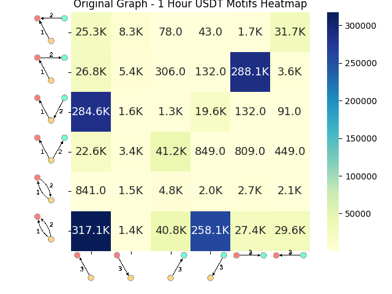
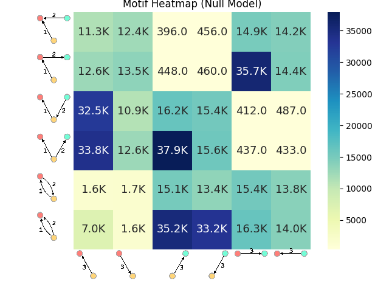
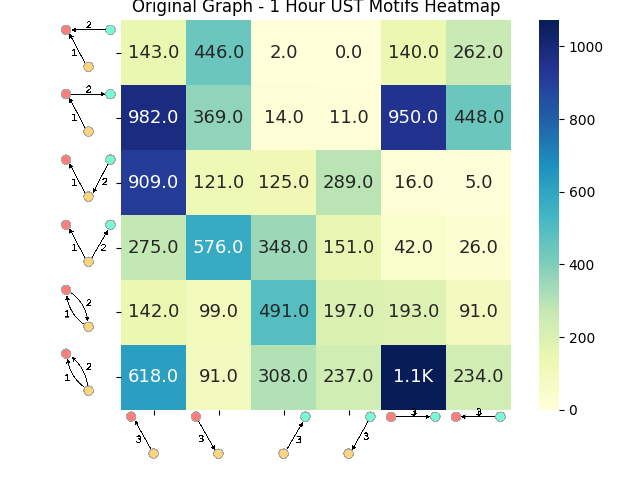

# Understanding cryptocurrency transactions with network motifs

Temporal network-motif analysis of Ethereum stablecoin transfers (USDT · USDC · DAI · UST · LUNA), including the May-2022 UST/LUNA collapse window. Raphtory temporal graphs → 3-node temporal motifs at 1h / 1d → timestamp-permutation null model → centrality, role classification and anomaly detection (DBSCAN · Isolation Forest).

对稳定币以太坊转账做时序网络 motif 研究（含 2022 年 5 月 UST/LUNA 崩盘窗口）：时序图 → 三节点 motif → 随机零模型 → 中心性、角色分类与异常检测。Observed motif heatmaps sit next to the null-model heatmaps, so the collapse window can be read against a timestamp-shuffled baseline.

**Pipeline modules live in the `.py` files. Figures for the May 2022 UST/LUNA window are the USDT, USDC, DAI, UST, and LUNA heatmaps plus `motif_heatmap_null_model.png`.**

## Root map

| Path | What it is |
|---|---|
| `*.py` | Pipeline stages. CI runs `python -m compileall` on these modules. |
| `USDT_1h_motifs_heatmap.png` | Lead 1-hour USDT heatmap, kept at the repository root |
| `motif_heatmap_null_model.png` | Timestamp-permutation null model, kept at the repository root |
| `figures/USDT_1d_motifs_heatmap.png` | USDT 1-day heatmap |
| `figures/USDC_1h_motifs_heatmap.png`, `figures/USDC_1d_motifs_heatmap.png` | USDC heatmaps |
| `figures/DAI_1h_motifs_heatmap.png`, `figures/DAI_1d_motifs_heatmap.png` | DAI heatmaps |
| `figures/UST_1h_motifs_heatmap.png`, `figures/UST_1d_motifs_heatmap.png` | UST heatmaps |
| `figures/LUNA_1h_motifs_heatmap.png`, `figures/LUNA_1d_motifs_heatmap.png` | LUNA heatmaps |
| `figures/` | The rest of the PNG outputs (address ranks, volumes, networks) |
| `notebooks/01_exploration.ipynb`, `notebooks/motif_all.ipynb` | Named exploratory notebooks |
| `notebooks/archive/scratch_01.ipynb` … `scratch_05.ipynb` | Former `Untitled` notebooks, archived |
| `requirements.txt` | Declared Python dependencies |
| `data_download_and_import.py` | Etherscan download stage (formerly a spaced filename) |

The `.py` files are the pipeline stages. Several scripts read local CSV paths produced by the previous stage and run when the file is executed. `ETHERSCAN_API_KEY` is read from the environment in `data_download_and_import.py` via `os.environ.get("ETHERSCAN_API_KEY", "")`.

## Data download

- `data_download_and_import.py` — Pages ERC-20 token transfers from the Etherscan `tokentx` API for the contract address configured in the script, and appends rows to `stablecoin_transactions_all1.csv`.

## Preprocessing

- `file.py` — `rename_columns` renames Etherscan-style columns (`blockNumber`, `transactionIndex`, `from`, `to`, `contractAddress`, `value`) and writes a CSV.
- `pre_process.py` — Drops rows with missing `from_address` or `to_address`, casts `value` to float, parses `time_stamp` into `timeStamp`, drops duplicate rows, and writes a CSV.
- `pre_process_compare.py` — Sorts by `timeStamp`, drops rows with missing `from` or `to`, casts `value`, and writes one CSV per `tokenSymbol`.
- `process_transactions.py` — Counts transfers per calendar day in `processed_transactions.csv` and writes `daily_transactions.csv`.
- `contract_address.py` — Prints the unique `contract_address` values in `token_transfers.csv`.
- `currency_type.py` — Splits a dataframe on `contract_address` into USDT, USDC, DAI, LUNA, UST, and PAX, using the address-to-name map in that file.

## Graph construction

- `graph_load.py` — Loads `processed_transactions.csv` into a Raphtory graph. `build_transaction_graph` builds the same kind of graph from a CSV and saves it (default `/tmp/saved_graph`).
- `raphtory-test.py` — Adds each row of `processed_transactions.csv` as a Raphtory edge, then saves the graph and loads it back.
- `detail_process.py` — Loads a CSV, builds a Raphtory transfer graph (edges, or edges plus node properties), sums address volume, writes the cumulative-volume prefix at 99.9% to `top_0_1_percent_addresses.xlsx`, plots that distribution, counts edges inside a caller-supplied time window, plots daily counts, and highlights days above a mean-plus-two-standard-deviations threshold.

## Motif analysis

- `motif_analysis.py` — Calls Raphtory `global_temporal_three_node_motif_multi` for a list of time windows in seconds and can save those counts to CSV.
- `main.py` — Runs daily counts, a highlighted daily plot, Raphtory graph construction, three-node motif counts at 3600 seconds and 86400 seconds, motif heatmaps, the timestamp-permutation null model, degree centrality, PageRank, and the labels from `classify_by_centrality.py`.

## Null model

- `Null_Model.py` — `generate_randomized_reference_model` permutes the timestamp column and leaves source and destination unchanged.

## Centrality

- `centrality_analysis.py` — Degree centrality, PageRank, and betweenness on a Raphtory graph. `process_centrality_algorithm` sorts the scores and writes `degree_centrality.csv`, `pagerank.csv`, or `betweenness.csv`.
- `classify_by_centrality.py` — Joins the PageRank and degree tables on `Node` and assigns `Seller`, `Buyer`, or `Shop` from the thresholds written in that function.

## Anomaly detection

- `anomaly-detection.py` — Reads `processed_transactions.csv`, keeps timestamps from 2022-05-01 through 2022-05-15, and prints or plots a 99th-percentile value cut, addresses above a count of 100, DBSCAN labels, and Isolation Forest labels.
- `address_pair_transactions.py` — Counts transfers sent and received by two addresses, including transfers between them, and counts how often one address meets other addresses.

## Visualization

- `plot_transactions.py` — Plots daily transfer counts with a 7-day average and a high-count marker, then a dual-axis chart of daily count and daily value.
- `heatmap_plotter.py` — Saves three-node motif heatmaps for an original graph and a randomized graph at 1 hour and 1 day. `plot_motifs_for_multiple_coins` writes per-coin 1-hour and 1-day heatmaps from the motif counts in `motif_analysis.py`.
- `currency_cross_corr.py` — Sums daily `value` before and after 2022-05-11 for the contract-address map in that file, and plots the maximum cross-correlation over lags from -7 to 7 days.

## Notebooks and figures

Named notebooks: `notebooks/01_exploration.ipynb` and `notebooks/motif_all.ipynb`.

Archived drafts, renamed from `Untitled.ipynb` through `Untitled4.ipynb`: `notebooks/archive/scratch_01.ipynb`, `scratch_02.ipynb`, `scratch_03.ipynb`, `scratch_04.ipynb`, `scratch_05.ipynb`.

Lead PNGs stay at the repository root. Every other PNG, including the USDC, DAI, UST, LUNA, and USDT 1-day heatmaps, is under `figures/`.

## Dependencies

`requirements.txt` lists `pandas`, `numpy`, `matplotlib`, `seaborn`, `requests`, `urllib3`, `raphtory`, `sklearn`, and `plot-transactions`.

## License

MIT. See [LICENSE](LICENSE).
